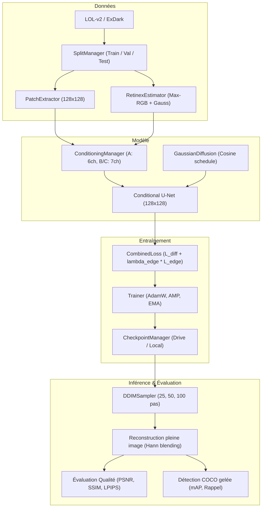
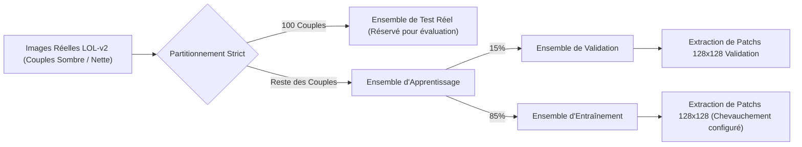
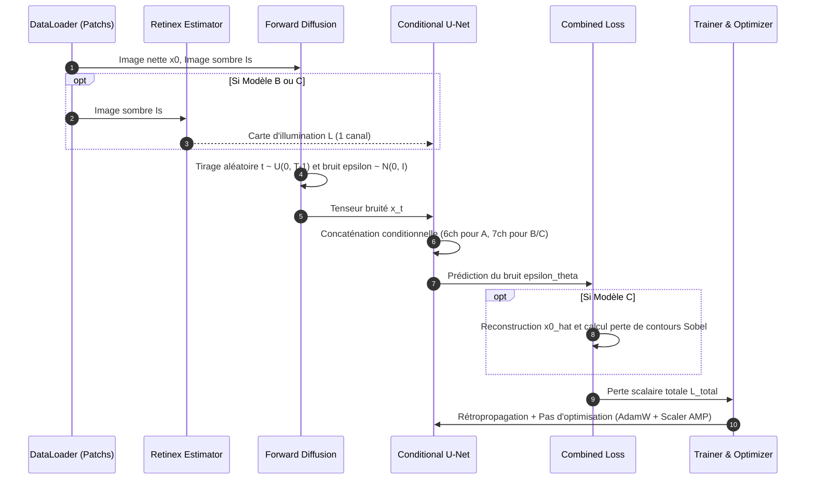

# Architecture Logicielle et Système — NightVision Gen

Ce document décrit l'organisation modulaire, les interactions entre sous-systèmes et les pipelines de traitement de NightVision Gen.

---

## 1. Vue d'Ensemble de l'Architecture

Le système s'articule autour de 6 modules principaux :
1. **`data/`** : Gestion des partitions, extraction de patchs 128x128 et DataLoaders.
2. **`illumination/`** : Estimation et lissage des cartes Retinex max-RGB.
3. **`models/`** : U-Net conditionnel, embeddings sinusoïdaux et formulation DDPM.
4. **`losses/`** : Perte de prédiction de bruit et contrainte de contours Sobel.
5. **`training/`** : Trainer indépendant, gestion des checkpoints d'état et journalisation.
6. **`sampling/` & `evaluation/`** : Échantillonnage DDIM rapide, métriques de qualité d'image et évaluation de détection gelée COCO.



---

## 2. Pipeline de Traitement des Données

Pour éviter toute fuite de données (*data leakage*), le découpage entre Train, Validation et Test est appliqué **avant** toute extraction de patchs.



---

## 3. Pipeline d'Entraînement du DDPM (Modèles A, B et C)



---

## 4. Pipeline d'Inférence et de Restauration Pleine Image

Pour toute image de résolution supérieure à 128 × 128, le module d'inférence segmente l'image en tuiles chevauchantes et applique une pondération 2D de Hann pour éliminer tout artéfact de raccord.

```mermaid
flowchart TD
    ImgIn["Image Sombre d'Entrée (Résolution arbitraire H x W)"] --> Decomp["Décomposition en tuiles 128x128 (stride=96)"]
    Decomp --> BatchPatches["Batch de patchs sombres"]
    
    opt Si Modèle B ou C
        ImgIn --> Illum["Calcul Carte Retinex globale"]
        Illum --> DecompIllum["Décomposition tuiles Retinex"]
        DecompIllum --> BatchPatches
    end
    
    BatchPatches --> DDIMStep["Échantillonnage DDIM (S=25, 50 ou 100 pas)"]
    DDIMStep --> RestoredPatches["Patchs restaurés 128x128"]
    RestoredPatches --> Stitching["Reconstruction 2D avec Fenêtrage de Hann"]
    Stitching --> FinalImage["Image Restaurée Finale (H x W, sans coutures)"]
```

